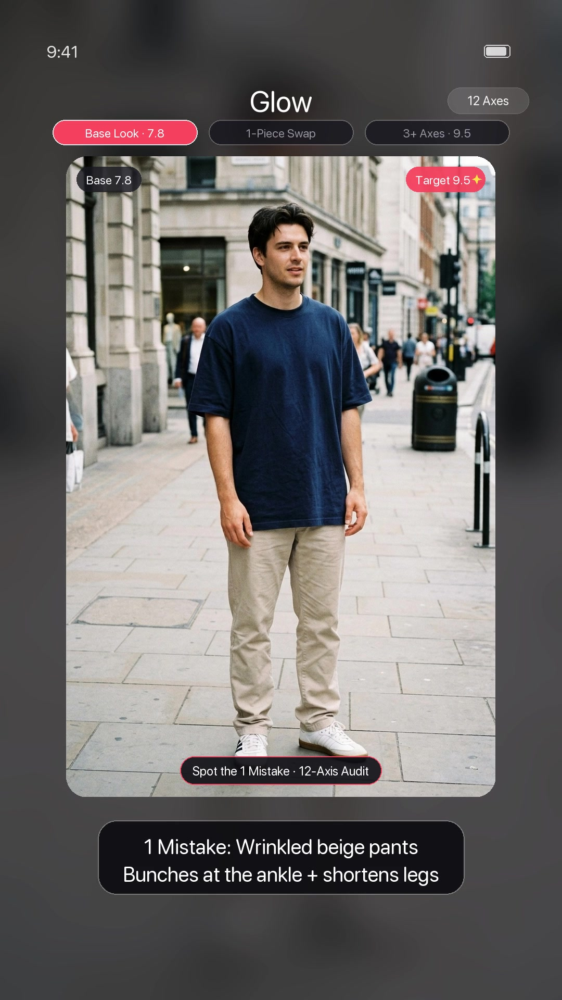
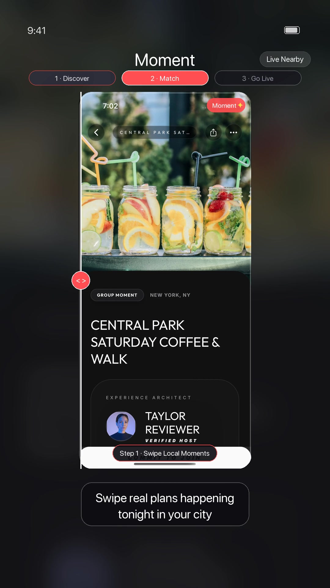
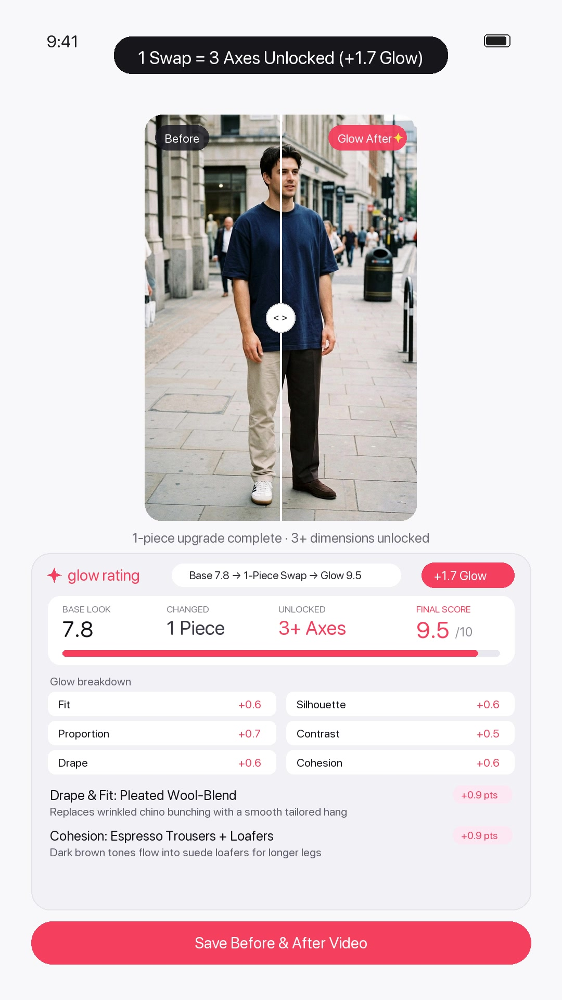
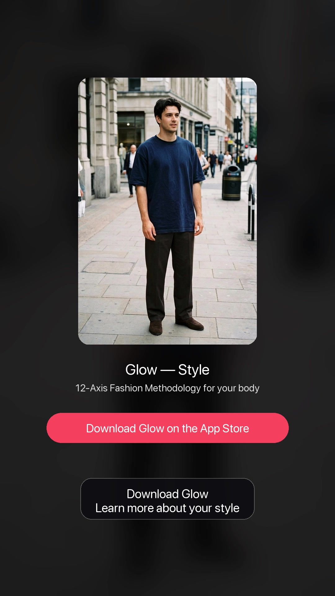

# 🎬 Universal Marketing Video Factory (`video-factory`)

An autonomous **Agent Skill & CLI Engine** for **Claude Code**, **Antigravity**, **Cursor**, and **Codex** that turns any mobile or web app repository into a high-retention 9:16 short-form video studio (TikTok, Instagram Reels, YouTube Shorts, Facebook Reels).

Point your AI coding agent at **any app repository**, and `video-factory` will:
1. **Auto-Inspect Your Repo's Look & Feel** (`scripts/inspect_repo.py`): Reads `app.json`, `package.json`, `README.md`, `tailwind.config.*`, and `globals.css` to extract your app name, tagline, value proposition, brand accent color, dark surface color, and existing screenshots.
2. **Choose the Optimal Visual Template (`scripts/factory/renderer.py`)**:
   - 📱 **`screen_walkthrough`**: Cycles through 2–3 real app UI screenshots inside an iOS status-bar frame with animated step callout pills, a dual-screen feature breakdown card, and a brand-colored CTA outro.
   - ✨ **`before_after_slider`**: Interactive `< >` comparison slider wipe across Before & After images with a multi-axis scoring & coaching sheet (ideal for photo, fashion, fitness, or design apps).
   - ⚖️ **`side_by_side_proof`**: Split-screen Before vs. After visual proof loop.
3. **Generate High-Trust Voiceovers & Master Audio (`scripts/factory/audio.py`)**: Uses the native OG TikTok TTS voices (`en_us_001` Jessie, `en_us_006` Male, `en_uk_001` British, `en_au_001` Australian) with `ffmpeg` loudness normalization (`dynaudnorm`) and transition pop SFX.
4. **Enforce Executive Quality Gates (`scripts/factory/script_manager.py`)**: Certifies 5th-grade plain-English readability (Flesch-Kincaid <= 6.5), high-retention pacing (< 75 words / 15–24s), PG brand safety, and post-render milestone frame extraction.
5. **Publish Headlessly (`scripts/distribute.py`)**: Optional one-command distribution to **YouTube Shorts**, **Instagram Reels**, **Facebook Reels**, and **TikTok**.

---

## 🎥 Example Output (`examples/glow_before_after_example.mp4`)

Included in [`examples/glow_before_after_example.mp4`](examples/glow_before_after_example.mp4) (rendered from [`examples/glow_before_after.json`](examples/glow_before_after.json)) is a full 19-second 1080×1920 vertical campaign generated for **Glow** (`#F43F5E` rose accent, OG TikTok Jessie voice `en_us_001`, interactive `< >` Before/After slider wipe, and 12-axis coaching breakdown sheet):

| Scene 1: The Hook (`0–5s`) | Scene 2: Slider Wipe (`5–12s`) | Scene 3: Coaching Sheet (`12–16s`) | Scene 4: Outro & CTA (`16–19s`) |
| :---: | :---: | :---: | :---: |
|  |  |  |  |

---

## 📊 Batch Series Generation: Prompt 1 Format → Spit Out 10+ Videos (`--count 10`)

You can point `video-factory` at an **example template** (`--example-template examples/glow_before_after.json`) and ask it to plan and render **10+ distinct videos in one batch** (`--count 10`), complete with pixel-locked Before/After photos generated via Gemini Nano Banana 2.1 (`--generate-images`).

Here is the real **12-Episode Batch Series Table** generated for **Glow** from a single methodology prompt:

| # | Episode ID | Scene 1 Hook (The 1 Mistake / Base Look) | Scene 2 Reveal (The 1-Piece Upgrade) | Score | Scene 3 Breakdown (Why It Works) |
| :-: | :--- | :--- | :--- | :-: | :--- |
| **1** | `ep01_fit_thigh_room` | **1 Mistake: Faded bunched jeans** — Drags down her whole lower half | **1 Swap: High-waist wide black jeans** — Room through the thighs | `7.8` → **9.5** | **Fit & Drape:** Wide-Leg Cut • **Balance:** Solid Black Base |
| **2** | `ep02_silhouette_column_balance` | **Base Look 7.8: Plain cream tee** — Missing outer structure on a broad frame | **1 Piece Added: Open olive overshirt** — Sharpens shoulder line | `7.8` → **9.4** | **Structure:** Workwear Collar & Seams • **Layering:** Open Front Frame |
| **3** | `ep03_proportion_cropped_jacket` | **1 Mistake: Wrinkled beige pants** — Bunches at the ankle + shortens legs | **1 Swap: Dark brown pleated trousers** — Zero knee or ankle wrinkles | `7.8` → **9.4** | **Drape & Fit:** Pleated Wool-Blend • **Cohesion:** Espresso Trousers + Loafers |
| **4** | `ep04_contrast_collar_frame` | **1 Mistake: Dark navy top on navy pants** — Zero waist break + flat around face | **1 Swap: Tucked crisp white crew tee** — Brightens his jawline | `7.7` → **9.3** | **Contrast:** High-Light Crew Collar • **Ratio:** 1/3 Tucked Top to 2/3 Legs |
| **5** | `ep05_drape_skirt_vs_pants` | **1 Mistake: Tight blue skinny jeans** — Pulls at the thighs + bunches at knees | **1 Swap: Flowing espresso maxi skirt** — Zero thigh pulling in motion | `7.8` → **9.5** | **Fit & Drape:** Fluid A-Line Skirt • **Cohesion:** Espresso Skirt + Tan Loafers |
| **6** | `ep06_structure_suede_vs_cardigan` | **Base Look 7.9: Cream top + black skirt** — Needs shoulder shape + 1/3 outer crop | **1 Piece Added: Cropped dark suede jacket** — Crisp shoulder line | `7.9` → **9.5** | **Structure & Ratio:** Waist-Cropped Suede • **Contrast:** Dark Suede vs Cream Knit |
| **7** | `ep07_balance_shoes_and_hem` | **1 Mistake: Tight tapered blue jeans** — Pinches the calves + breaks leg line | **1 Swap: High-waist cream wide trousers** — Fluid motion with every step | `7.8` → **9.4** | **Drape:** Wide-Leg Tailored Cut • **Balance:** Low-Profile Gum Trainers |
| **8** | `ep08_pattern_matte_textures` | **1 Mistake: Flat untucked oatmeal tee** — Covers the waist + lacks fabric texture | **1 Swap: Tucked waffle-knit crew tee** — Tactile 3D waffle weave | `7.8` → **9.4** | **Texture:** Heavyweight Waffle Knit • **Ratio:** Exposed Pleated Waistline |
| **9** | `ep09_layering_two_piece_depth` | **Base Look 7.8: White tee + dark jeans** — Clean base, but flat 1-layer upper body | **1 Piece Added: Open olive overshirt** — Instant 2-piece depth | `7.8` → **9.4** | **Layering:** Unbuttoned Workwear Overshirt • **Contrast:** White Center Strip |
| **10** | `ep10_details_waist_tuck` | **Base Look 7.9: Cream knit + navy trousers** — Needs outer structure + warm accent | **1 Addition: Cropped olive wool jacket** — Crisp shoulder & hem line | `7.9` → **9.5** | **Structure & Ratio:** Cropped Wool Jacket • **Details:** Cognac Shoulder Bag |
| **11** | `ep11_cohesion_warm_tones` | **1 Mistake: Icy washed blue jeans** — Cool denim clashes with warm oatmeal top | **1 Swap: Wide dark espresso trousers** — 100% warm autumn palette | `7.8` → **9.5** | **Cohesion:** Warm Oatmeal + Espresso • **Drape:** Wide Tailored Leg |
| **12** | `ep12_focal_point_burgundy_bag` | **Base Look 8.0: Cream knit + black midi skirt** — Missing outer edge + color pop | **1 Addition: Cropped matte leather jacket** — Sharpens shoulders & waist | `8.0` → **9.6** | **Focal Point:** Deep Burgundy Shoulder Bag • **Structure:** Matte Leather |

---

## 🤖 Full Automation Prompts (Copy-Paste for Claude Code / Antigravity / CLI)

### 1. The Agent Prompt (Give this to Claude Code, Antigravity, Cursor, or Codex)
Once you install the skill (`git clone https://github.com/10xVector/video-factory.git ~/.claude/skills/video-factory`), paste this single prompt into your coding agent to automate the entire 10-video pipeline:

```text
Use the video-factory skill to generate a 10-episode short-form video series for my app:
1. Inspect my repo for brand colors, app name, and tagline.
2. Follow the format and pacing of examples/glow_before_after.json.
3. Plan a 10-episode series table around "<YOUR SERIES THEME / PERSONA>" where each episode highlights 1 specific mistake/problem and 1 instant upgrade/fix in plain 5th-grade English (<60 words per script).
4. Generate pixel-locked Before & After image pairs for all 10 episodes using scripts/generate_pair.py (Gemini Nano Banana 2.1), render all 10 1080x1920 MP4s with voice en_us_001, and run the visual QA audit.
```

### 2. The Underlying System Prompt (How the Engine Plans 10 Episodes + Image Pairs)
If you want to see or customize the exact LLM prompt that converts **1 example template + 1 theme** into **10 structured episode scripts + Before/After image prompts**, see **[`scripts/video_factory.py` (Lines 161–210)](scripts/video_factory.py#L161-L210)**:

```text
You are a world-class short-form video creative director for "{app_name}" ({tagline}).
App Description: {desc}
Target Video Format: {v_format}
Series Theme / Target Persona: "{persona}"
Number of Distinct Episodes to Generate: {count}

Follow the exact pacing, badge style, and narrative rhythm of this reference template:
{example_template_json}

Strict Creative Standards for EVERY Episode:
1. Plain 5th-Grade English ("Caveman clarity"): Use short, punchy, everyday words. Zero corporate buzzwords.
2. Total spoken word count across all 4 scenes MUST be under 60 words (15-20 seconds total).
3. 4-Scene Narrative:
   - Scene 1 (Hook): Relatable visual mistake, dilemma, or base look score (1 short sentence).
   - Scene 2 (Reveal): The 1-piece swap or instant app solution that fixes it (1-2 short sentences).
   - Scene 3 (Breakdown Sheet): 2 concrete reasons why it works (1 short sentence).
   - Scene 4 (Outro CTA): Low-friction call to action (1 short sentence).
4. If generating Before/After transformations, specify `swap_zone` ("lower" for pants/skirt/shoes swaps, or "upper" for shirt/jacket/layer swaps) plus `before_image_prompt` and `after_edit_prompt` so Nano Banana 2.1 can generate a pixel-locked pair.
```

### 3. One-Command Fully Unattended CLI Automation (Plan → Images → Render → Publish)
To run the entire factory headlessly (e.g., in a cron job or GitHub Action) from idea to published TikTok / Instagram Reel / YouTube Short:

```bash
export GEMINI_API_KEY="AIzaSy..."

python3 scripts/video_factory.py \
  --repo /path/to/your/app \
  --example-template examples/glow_before_after.json \
  --persona "12-axis fashion methodology — 1-piece outfit upgrades for everyday men and women" \
  --count 10 \
  --generate-images \
  --voice en_us_001 \
  --publish \
  --platforms youtube,instagram,facebook,tiktok \
  --output-dir ./marketing_output
```

---

## 🚀 Quick Install (For Claude Code, Antigravity, Cursor, & Codex Users)

### Option 1: One-Line Installer
Clone and run the installer to register `video-factory` globally across `~/.claude/skills/`, `~/.agents/skills/`, and `~/.gemini/config/skills/`:

```bash
git clone https://github.com/10xVector/video-factory.git
cd video-factory
./install.sh
```

### Option 2: Direct Clone into Claude Code or Workspace
```bash
# Global install for Claude Code (available in all your projects):
git clone https://github.com/10xVector/video-factory.git ~/.claude/skills/video-factory

# Global install for Antigravity / Codex / Cursor:
git clone https://github.com/10xVector/video-factory.git ~/.agents/skills/video-factory

# Or per-project install inside your app repository:
git clone https://github.com/10xVector/video-factory.git .claude/skills/video-factory
```

### System Requirements
- **macOS or Linux** with `python3` (3.9+)
- **FFmpeg** (`brew install ffmpeg` on macOS or `apt install ffmpeg` on Ubuntu)
- **Pillow** (`pip install Pillow`)

---

## 💬 How to Use with Claude Code or Antigravity

Once installed, simply ask your agent in natural language inside any project:

> *"Use the `video-factory` skill to create a 20-second TikTok marketing video for this repo. Inspect our app's colors and screenshots, use the OG TikTok Jessie voice, and target a Friday night hangout angle."*

Or specify a target repo, look, and voice:

> *"Run `video-factory` on `~/code/my-app` with accent color `#6366F1`, voice `en_us_001`, and our 3 onboarding screenshots."*

### What the Agent Will Ask / Configure for You
1. **Target Repo & Screenshots**: Auto-detected from `screenshots/`, `public/marketing/`, or `assets/` (or you can specify any 2–3 portrait images).
2. **App Look & Brand Theme**: Auto-extracted from your Tailwind/CSS theme (`primary_accent_rgb`, `surface_bg_rgb`, `app_name`, `tagline`), with full support for custom overrides.
3. **Voice Selection**:
   - `en_us_001` (`tiktok-jessie` — OG TikTok Female voice, **default**)
   - `en_us_006` (`tiktok-male` — TikTok Male voice)
   - `en_male_narration` (`tiktok-narrator` — Storyteller narrator)
   - `en_uk_001` (`tiktok-uk` — British voice)
   - `en_au_001` (`tiktok-au` — Australian voice)
4. **Credentials (Optional)**:
   - **No API Key Needed for Agent-Authored Campaigns**: When running inside Claude Code or Antigravity, the agent can write the campaign JSON directly using your repo's context—requiring **zero external LLM API keys**.
   - **Gemini API Key (`GEMINI_API_KEY`)**: Only needed if you run the standalone CLI `--persona` mode to have Gemini brainstorm the script.

---

## 🛠️ Standalone CLI Usage

You can also run the Video Factory directly from your terminal without an agent:

### 1. Inspect Any App Repository
Automatically extract a repo's brand colors, app name, tagline, and screenshots into a `brand.json` file:
```bash
python3 scripts/inspect_repo.py /path/to/your/app --save brand.json
```

### 2. Configure Your Gemini Key & Social Credentials (Optional)
Initialize `~/.config/video-factory/credentials.json` (`0600` permissions):
```bash
# Save your Gemini API key for --persona brainstorming:
python3 scripts/video_factory.py --init-credentials --gemini-key "AIzaSyYourGeminiKey..."

# Check credential status across Gemini, YouTube, Instagram, Facebook, and TikTok:
python3 scripts/video_factory.py --check-auth --app-name my_app
```

You can also set `GEMINI_API_KEY` in your environment or `.env` file.

### 3. Render a Video from a Template JSON
Customize [`examples/moment_friday_hangout.json`](examples/moment_friday_hangout.json) (for `screen_walkthrough`) or [`examples/glow_before_after.json`](examples/glow_before_after.json) (for `before_after_slider`) and run:
```bash
python3 scripts/video_factory.py \
  --template examples/moment_friday_hangout.json \
  --screens /path/to/screen1.png /path/to/screen2.png /path/to/screen3.png \
  --app-name "Moment" \
  --accent-color "#FF4E50" \
  --voice en_us_001 \
  --output-dir ./marketing_output
```

### 4. Auto-Plan & Render 1 or 10+ Videos from a Persona / Example Format via Gemini
```bash
# Spit out a 10-video series following an example format (plus auto-generate Before/After photos):
python3 scripts/video_factory.py \
  --repo /path/to/your/app \
  --example-template examples/glow_before_after.json \
  --persona "12-axis fashion methodology — 1-piece outfit upgrades for everyday men and women" \
  --count 10 \
  --generate-images \
  --output-dir ./marketing_output

# Or preview the 10-episode Markdown table & JSON plans first without rendering:
python3 scripts/video_factory.py \
  --example-template examples/glow_before_after.json \
  --persona "12-axis fashion methodology — 1-piece outfit upgrades" \
  --count 10 \
  --plan-only \
  --output-dir ./marketing_output
```

### 5. Standalone Before/After Image Pair Generator (`scripts/generate_pair.py`)
Generate certified **0.0-pixel-drift** Before & After photo pairs using **Gemini Nano Banana 2.1** (`gemini-nano-banana-2.1`) with automatic **Single-Piece Pixel-Lock Compositing**:
```bash
python3 scripts/generate_pair.py \
  --before-prompt "Full-body 2:3 street style photo of a 30yo man on a Soho sidewalk wearing a fitted olive field jacket over a white tee, paired with wrinkled baggy beige chinos. Natural daylight." \
  --after-edit-prompt "Swap ONLY the wrinkled beige chinos for dark brown pleated wool trousers and espresso loafers." \
  --swap-zone lower \
  --output-before ./marketing_output/assets/before.jpg \
  --output-after ./marketing_output/assets/after.jpg
```

### 6. Publish (or Dry-Run) to YouTube Shorts, Instagram Reels, Facebook Reels, & TikTok
```bash
# Dry-run simulation across all 4 platforms:
python3 scripts/distribute.py \
  --video ./marketing_output/moment_friday_night_irl.mp4 \
  --brand moment \
  --platforms youtube,instagram,facebook,tiktok \
  --dry-run

# Live publish to YouTube Shorts & Instagram Reels:
python3 scripts/distribute.py \
  --video ./marketing_output/moment_friday_night_irl.mp4 \
  --brand moment \
  --platforms youtube,instagram
```

---

## 🎨 Customizing Your App's Look & Feel (`CampaignConfig` Schema)

Every campaign JSON template supports a `brand` block so your video matches your app's exact design system:

```json
{
  "name": "my_app_launch_campaign",
  "output_filename": "my_app_launch.mp4",
  "format": "screen_walkthrough",
  "voice": "en_us_001",
  "screenshots": [
    "screenshots/01-home.png",
    "screenshots/02-detail.png",
    "screenshots/03-Action.png"
  ],
  "brand": {
    "app_name": "MyApp",
    "tagline": "Do it faster",
    "header_badge_text": "Live on iOS",
    "primary_accent_rgb": [255, 78, 80],
    "surface_bg_rgb": [18, 18, 22],
    "status_bar_time": "9:41",
    "tracker_pills": [
      "1 · Discover",
      "2 · Connect",
      "3 · Launch"
    ],
    "sheet_badge_label": "why myapp works",
    "sheet_pill_text": "Discover → Connect → Launch",
    "sheet_highlight_pill": "10x Faster"
  }
}
```

See [`SKILL.md`](SKILL.md) for the complete agent workflow instructions and [`examples/`](examples/) for ready-to-run templates.
